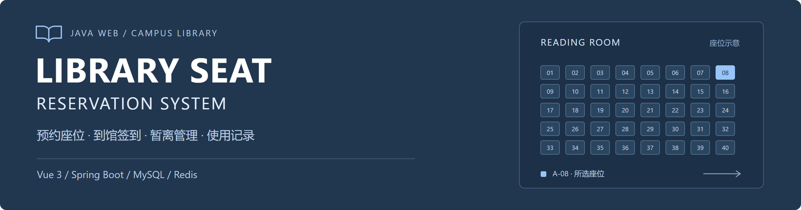
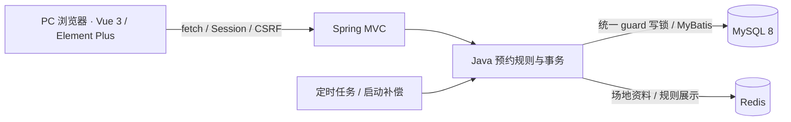

<p align="center">
  
</p>

<h1 align="center">图书馆座位预约管理系统</h1>

<p align="center">
  面向校园图书馆的 PC 端预约与使用管理。<br>
  从选座预约、到馆签到到离座签退，连接学生自助使用与管理员日常维护。
</p>

<p align="center">
  <a href="https://github.com/17elr/library-seat-reservation-system/actions/workflows/ci.yml"></a>
  
  
  
  
  
</p>

<p align="center">
  <a href="#界面预览">界面预览</a> ·
  <a href="#快速开始">快速开始</a> ·
  <a href="#功能一览">功能一览</a> ·
  <a href="#技术实现">技术实现</a> ·
  <a href="docs/README.md">项目文档</a> ·
  <a href="docs/INTERVIEW.md">面试说明</a>
</p>

> **版本说明**：本页对应 `feature/vue-reservation-cache` 的 Vue 版本，改动集中在 [PR #2](https://github.com/17elr/library-seat-reservation-system/pull/2)，保留主分支供审核。旧版基线见 [legacy tag](https://github.com/17elr/library-seat-reservation-system/tree/legacy/library-seat-20261024)。

## 界面预览

**预约座位** — 日期与时段选择、阅览室配图、插座 / 靠窗筛选、键盘选座与预约确认。

[](docs/SHOWCASE.md#预约座位)

<table>
  <tr>
    <td width="50%"><a href="docs/images/vue/login.png"></a></td>
    <td width="50%"><a href="docs/images/vue/admin.png"></a></td>
  </tr>
  <tr>
    <td align="center">统一登录入口</td>
    <td align="center">管理员工作台</td>
  </tr>
</table>

[查看完整截图与操作说明 →](docs/SHOWCASE.md)

## 快速开始

需要 **JDK 21、Node.js 22.12+、Maven、Docker Compose**。Compose 提供 MySQL 8 与 Redis 7.4；也可以连接已有的专用数据库与 Redis，配置见[部署说明](docs/deployment.md)。

### 1. 准备环境

```powershell
git clone --branch feature/vue-reservation-cache https://github.com/17elr/library-seat-reservation-system.git
cd library-seat-reservation-system
Copy-Item .env.example .env
```

编辑 `.env` 中的 `MYSQL_ROOT_PASSWORD` 和 `DB_PASSWORD`，并设置 `JAVA_HOME` 指向 JDK 21。

### 2. 启动演示

```powershell
docker compose up -d --wait
./scripts/start-local.ps1 -Demo
```

脚本自动安装前端依赖、构建 Vue 页面与 Boot jar，再启动应用。浏览器访问 **http://127.0.0.1:18082**。

| 角色 | 演示账号 | 演示密码 |
| --- | --- | --- |
| 管理员 | `admin` | `Admin123!` |
| 学生 | `20260001` — `20260020` | `Student123!` |

`-Demo` 仅用于专用演示库，且只在用户表为空时生成账号与场地。默认启动不生成演示账号；已有数据升级见[迁移手册](docs/MIGRATION.md)。

<details>
<summary><strong>前后端分别开发、构建与停止服务</strong></summary>

后端启动后，前端可独立运行：

```powershell
npm ci --prefix web
npm run dev --prefix web
```

开发地址为 `http://127.0.0.1:18083`，`/api` 和 `/images` 代理到后端 `18082`。

```powershell
# 同源构建：先构建 Vue，再打包 Boot
npm run build --prefix web
mvn -B -ntp -DskipTests package

# 停止本目录启动的应用与 Compose 服务，保留数据库卷
./scripts/stop-local-app.ps1
./scripts/stop-local-db.ps1
```

| 服务 | 本机端口 | 用途 |
| --- | --- | --- |
| Spring Boot | `18082` | 同源页面与 API |
| Vite | `18083` | 前端开发 |
| MySQL | `13318` | 业务数据库，绑定回环地址 |
| Redis | `16378` | 静态资料缓存，绑定回环地址 |

Linux / macOS 的环境变量与启动命令见[部署说明](docs/deployment.md)。

</details>

## 功能一览

| 使用者 | 功能 | 关键规则 |
| --- | --- | --- |
| 学生 | 日期 / 时段 / 阅览室选择、编号搜索、插座与靠窗筛选、自动选座 | 每人同时最多一条有效预约 |
| 学生 | 预约、取消、签到、暂离、返回、签退 | 半小时网格、签到窗口、暂离次数与期限 |
| 学生 | 本人预约详情、操作事件、违约记录、公告与规则、修改密码 | 本人数据范围与旧会话失效 |
| 管理员 | 学生创建、启停、密码重置 | 停用关闭有效预约，重置密码保留预约 |
| 管理员 | 阅览室、座位、特殊日期开放、规则版本与公告 | 场地维护立即校验，旧预约沿用原规则 |
| 管理员 | 预约查询与关闭、违约撤销、统计与审计 | 维护原因留痕，撤销后重算预约限制 |

## 技术实现



| 层次 | 技术 | 在项目中的职责 |
| --- | --- | --- |
| 页面 | Vue 3、Element Plus、JavaScript、Vite | SFC、Composition API、键盘选座与失败恢复 |
| 请求 | 原生 fetch、HttpSession、CSRF | 同源登录，服务端角色与本人数据校验 |
| 服务 | Java 21、Spring Boot 3.5.16、Spring MVC | 预约生命周期、规则版本、参数校验 |
| 持久化 | MyBatis 3.0.5、MySQL 8、Flyway | 事务、事件与使用区间、编号数据库迁移 |
| 恢复与缓存 | Spring Scheduling、Redis | 最多 200 条候选一批的超时处理、静态资料缓存 |
| 验证 | JUnit、MockMvc、Playwright、GitHub Actions | 真实 MySQL / Redis 集成测试与浏览器回归 |

<details>
<summary><strong>实现中值得核对的五个细节</strong></summary>

1. **一致性**：所有业务写在 MySQL 事务中先锁 `write_guard(id=1)`，再读取当前状态；预约、事件、使用区间和违约共同提交。
2. **重试幂等**：`(user_id, request_key)` 唯一约束；同 key 同参数返回原预约，异参数返回 `409`。网络重试复用原 key。
3. **时间规则**：预约绑定创建时的 `rule_id`，注入 `Clock` 验证截止前、恰好截止、截止后的行为；签到 / 暂离边界不会被新规则追溯修改。
4. **只读查询**：GET 不触发持锁写扫描；计算到期状态标记为待归档，定时任务、启动补偿和相关写操作负责恢复。
5. **缓存边界**：Redis 仅缓存阅览室、座位静态属性和规则展示，TTL 120—150 秒，事务提交后失效，故障回源；预约和权限以 MySQL 最终读取为准。

实现位置、状态图和边界说明见[架构文档](docs/architecture-overview.md)，接口见[API 清单](docs/API.md)。

</details>

## 验证与质量

| 验证 | 最近记录 | 证据 |
| --- | --- | --- |
| 后端集成 | **33 项通过，0 跳过** | [测试清单](docs/evidence/backend-test-summary.json) |
| 关键浏览器流程 | **6 项通过** | [覆盖范围与截图](docs/TESTING.md#浏览器6项) |
| 前端时间测试 | **1 项通过** | [测试代码](web/tests/time.test.js) |
| 数据迁移与回退 | **原列摘要一致，新增历史保留** | [独立副本演练](docs/TESTING.md#非空数据演练) |
| 持续集成 | Java 21 / MySQL 8 / Redis 7.4 / Chromium | [Actions](https://github.com/17elr/library-seat-reservation-system/actions/workflows/ci.yml) |

<details>
<summary><strong>本地执行验证</strong></summary>

准备独立的 `library_seat_test` 数据库并设置 `TEST_DB_URL`、`TEST_DB_USER`、`TEST_DB_PASSWORD` 后执行：

```powershell
npm ci --prefix web
npm run format:check --prefix web
npm run format:java:check --prefix web
npm test --prefix web
npm run build --prefix web
mvn -B -ntp verify
```

另起专用演示库应用，再执行浏览器测试：

```powershell
npm run test:e2e --prefix web
```

本机 Edge 可设置 `PLAYWRIGHT_CHANNEL=msedge`；完整环境、故障注入和 SQL 计划见[测试证据](docs/TESTING.md)。

</details>

## 项目结构

```text
library-seat-reservation-system/
├── web/                         # Vue 页面、组件与浏览器测试
├── src/main/java/cn/edu/library/
│   ├── config/                  # 初始化、数据库迁移、超时调度
│   ├── web/                     # API、Session / CSRF、统一错误响应
│   ├── service/                 # 预约事务、纯状态判定、资料缓存
│   ├── mapper/                  # MyBatis 接口
│   └── model/                   # 业务模型
├── src/main/resources/
│   ├── mapper/                  # SQL 映射
│   ├── db/                      # 建表与编号迁移 SQL
│   └── static/images/           # 图书馆配图与来源
├── src/test/                    # 真实 MySQL 集成测试
├── scripts/                     # 启停、备份、摘要校验、回退演练
├── docs/                        # 架构、接口、测试、部署与截图
└── .github/                     # CI、协作模板与首页素材
```

## 文档导航

| 从这里开始 | 说明 |
| --- | --- |
| [文档中心](docs/README.md) | 按运行、实现与验收查找资料 |
| [界面图集](docs/SHOWCASE.md) | 登录、选座、详情、管理概览与失败恢复 |
| [部署说明](docs/deployment.md) | 本地运行、同源交付与环境变量 |
| [架构与状态](docs/architecture-overview.md) / [API 清单](docs/API.md) | 看懂业务规则与代码组织 |
| [迁移与回退](docs/MIGRATION.md) | 备份、原规则回填、校验与保留新增历史 |
| [测试证据](docs/TESTING.md) / [面试说明](docs/INTERVIEW.md) | 核对实现、验证结果与技术取舍 |
| [参与维护](CONTRIBUTING.md) / [更新记录](docs/CHANGELOG.md) | 反馈问题与提交改动 |

## 项目说明

本项目用于课程设计与作品集展示。演示种子为 120 个座位、20 个学生账号；竞争一致性测试不代表真实学校规模或生产 QPS。当前采用单实例 Session 与统一写 guard，Redis 缓存保留数据库最终校验。

图书馆照片为环境示意，来源见[素材说明](src/main/resources/static/images/SOURCES.md)。本页截图来自真实运行结果，封面由仓库内 [SVG 源文件](.github/assets/banner.svg) 绘制。

<details>
<summary>展示方式参考</summary>

参考 [Halo](https://github.com/halo-dev/halo) 的简介、快速开始和文档入口，[Novu](https://github.com/novuhq/novu) 的封面与截图组织，以及 [RuoYi-Vue](https://github.com/yangzongzhuan/RuoYi-Vue) 的功能与演示说明。仅借鉴信息组织，业务代码和项目截图来自本仓库。

</details>
