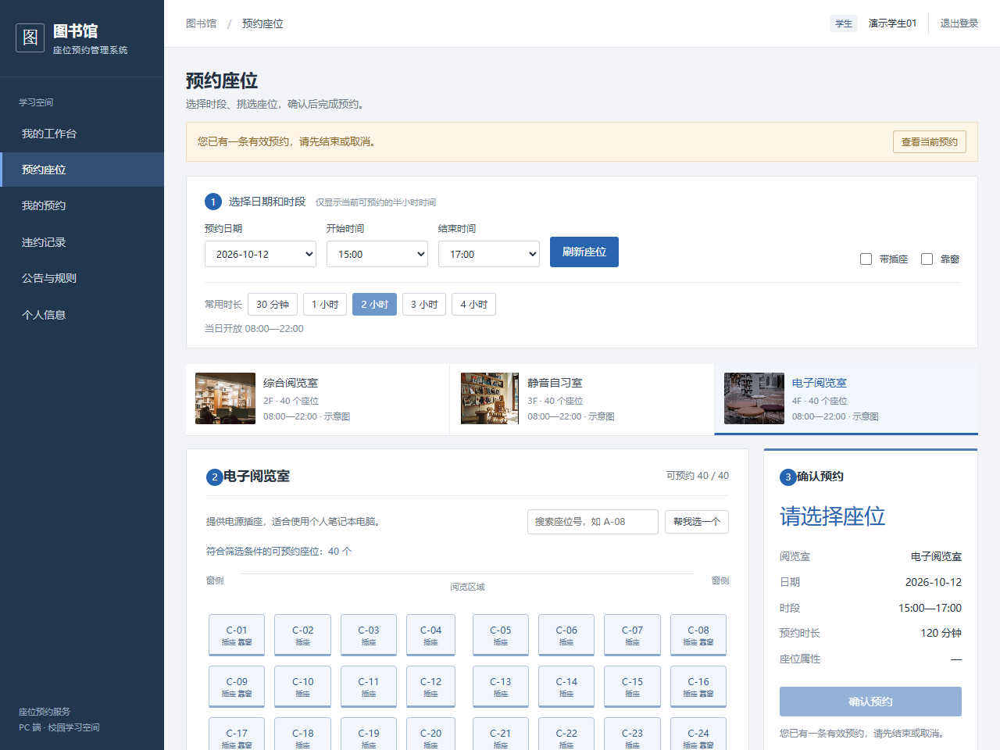
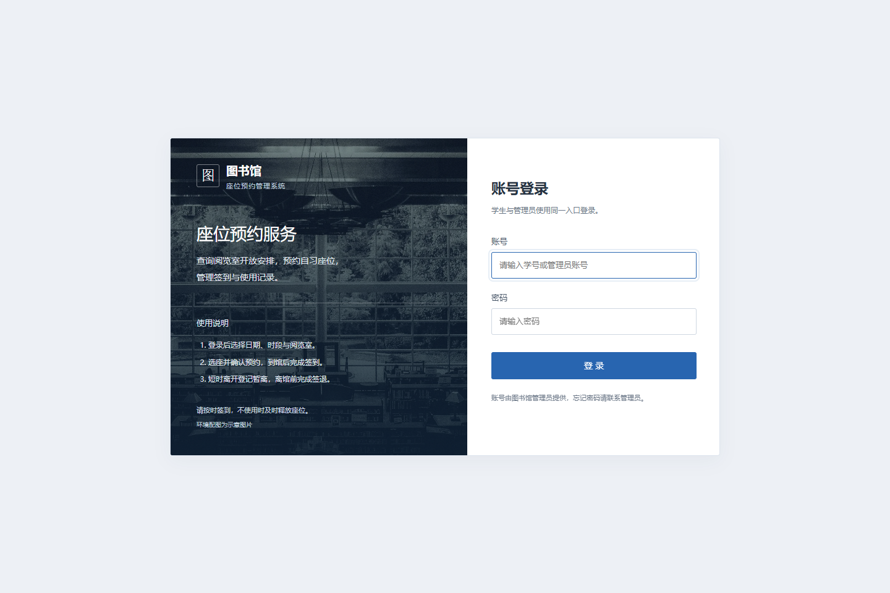
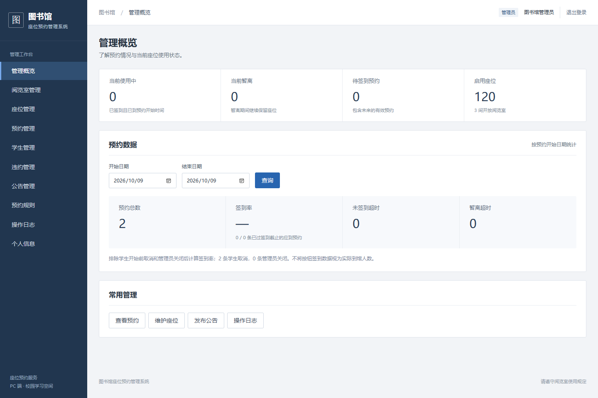

<div align="center">

# 图书馆座位预约管理系统

## 项目证据与个人贡献

[负责模块与关键技术决策](docs/PORTFOLIO.md) · [当前架构说明](docs/architecture-overview.md) · [持续集成](.github/workflows/ci.yml)


**Library Seat Reservation System**

面向校园图书馆的 PC 端座位预约与使用管理应用<br>
从选座预约、到馆签到到离座签退，连接学生自助使用与管理员日常管理。


[](https://github.com/17elr/library-seat-reservation-system/actions/workflows/ci.yml)

[快速启动](#快速启动) · [界面预览](#界面预览) · [功能一览](#功能一览) · [项目文档](docs/README.md) · [更新记录](docs/CHANGELOG.md)

</div>

---

## 项目介绍

基于 Spring Boot、Spring Security、MyBatis 和 MySQL 构建，采用 Thymeleaf 与原生 JavaScript 实现学生端和管理员端，无需单独部署前端服务。

系统管理学习座位及预约使用流程：学生按日期、时段和阅览室选座，管理员维护场地与规则；预约冲突检查、超时释放、规则版本和操作日志由后端统一处理。适合课程设计、毕业设计及本地功能演示。

## 界面预览

### 学生端 · 可视化选座



<details>
<summary>查看登录页与管理员概览</summary>

**统一登录入口**



**管理员工作台**



</details>

截图来自本地演示环境，账号与统计为演示数据，日期及座位状态仅代表截图时刻。界面环境图为示意素材，[来源记录](src/main/resources/static/images/SOURCES.md)随项目保留。

## 功能一览

| 模块 | 学生端 | 管理员端 |
| --- | --- | --- |
| 座位与场地 | 按房间、日期、时段选座；编号搜索；插座 / 靠窗筛选；自动选座 | 阅览室与座位新增、编辑、停用；特殊日期开放与闭馆 |
| 预约使用 | 预约、取消、签到、暂离、返回、签退 | 预约查询、异常关闭与原因记录 |
| 使用记录 | 个人预约、日期 / 进行中筛选、详情时间线、违约记录 | 违约查询与撤销、操作日志 |
| 账号管理 | 登录、个人信息、修改密码 | 学生创建、启用 / 停用、密码重置、旧会话失效 |
| 公告与规则 | 查看公告和预约规则 | 公告发布 / 撤下、规则版本管理 |
| 数据概览 | 个人工作台 | 当前使用状态、日期范围预约统计与签到率 |

### 实现要点

- **完整状态流转**：预约、签到、暂离、返回、结束和异常关闭均保留事件记录。
- **一致性保障**：事务与数据库行锁防止抢座冲突，请求标识避免重复预约。
- **规则可追溯**：预约引用创建时的规则版本，规则变更不追溯修改历史预约。
- **权限与认证**：BCrypt、Session、CSRF、本人数据校验与管理员角色授权。
- **超时补偿**：后台扫描和应用启动补偿处理未签到、暂离超时及预约到期。

## 快速启动

准备 **JDK 21+、Maven、MySQL 8.0**。Windows PowerShell：

```powershell
git clone https://github.com/17elr/library-seat-reservation-system.git
cd library-seat-reservation-system
powershell -NoProfile -ExecutionPolicy Bypass -File scripts/start-local.ps1
```

访问 **<http://127.0.0.1:8080>**。

| 角色 | 演示账号 | 演示密码 |
| --- | --- | --- |
| 管理员 | `admin` | `Admin123!` |
| 学生 | `20260001` 至 `20260020` | `Student123!` |

首次运行自动建立 **3 个阅览室、120 个座位、20 名虚构学生**，数据持久保存。脚本启动专用 MySQL 实例，端口为 `13307`，不修改现有 MySQL80 服务。演示凭据仅用于本地隔离环境。

MySQL 安装路径、自定义 JDK、停止服务、已有数据库和正式部署方式见[快速启动与部署](docs/deployment.md)。

## 技术与结构

| 层次 | 技术 |
| --- | --- |
| 运行与构建 | Java 21、Maven |
| 服务端 | Spring Boot 3.5.7、Spring MVC、Bean Validation |
| 认证授权 | Spring Security、Session、BCrypt、CSRF |
| 数据访问 | MyBatis 3.0.4、MySQL 8.0、HikariCP |
| 界面 | Thymeleaf、原生 JavaScript、CSS |
| 验证 | JUnit 5、Spring Boot Test、MockMvc、GitHub Actions |

```text
.
├── .github/                     # 自动构建、Issue / PR 模板
├── docs/                        # 部署、架构、更新记录与界面截图
├── scripts/                     # Windows 本地启动与停止脚本
├── src/
│   ├── main/
│   │   ├── java/cn/edu/library/
│   │   │   ├── config/          # 安全、初始化与超时调度
│   │   │   ├── mapper/          # MyBatis 数据访问接口
│   │   │   ├── model/           # 数据模型
│   │   │   ├── service/         # 业务规则与事务
│   │   │   └── web/             # 页面、API 与参数校验
│   │   └── resources/
│   │       ├── db/              # 数据库建表脚本
│   │       ├── mapper/          # SQL 映射
│   │       ├── static/          # 样式、脚本与图片
│   │       └── templates/      # 页面模板
│   └── test/                    # 集成测试与独立测试配置
├── .gitattributes               # 文本换行与二进制文件规则
├── .gitignore                   # 本地数据及个人材料排除规则
├── pom.xml
└── README.md
```

## 测试

先启动专用数据库，再测试并打包：

```powershell
powershell -NoProfile -ExecutionPolicy Bypass -File scripts/start-local.ps1 -DatabaseOnly
mvn -B -ntp verify
```

现有 **19 项集成测试**覆盖预约生命周期、并发抢座、幂等、时间边界、事务回滚、权限、CSRF 和密码重置等。测试只操作独立的 `library_seat_test` 数据库，执行前校验库名。GitHub Actions 使用 Java 21 与 MySQL 8.0 自动运行验证。

详细测试范围及事务设计见[架构与测试](docs/architecture.md)。

## 使用边界

- 当前面向 PC，建议浏览器宽度至少 1280px；不包含手机页面、小程序或门禁 / 定位签到。
- 按钮签到仅验证账号与时间，不能证明实际到馆；统计不将其视为真实到馆人数。
- 写操作采用统一行锁，适合当前演示规模；尚未验证大规模高并发吞吐。
- 场地停用与闭馆立即处理受影响预约，不支持未来排期生效的场地停用。
- 当前统计提供预约与签到等明确口径指标，不提供缺少历史开放区间支持的座位使用率。
- `local` 配置包含公开演示凭据，正式部署需显式使用 `prod` 并配置独立账号、HTTPS 和安全 Cookie。

## 文档与反馈

- [文档导航](docs/README.md)：部署、架构及原始设计记录。
- [更新记录](docs/CHANGELOG.md)：当前版本功能与修复。
- [提交问题](https://github.com/17elr/library-seat-reservation-system/issues/new/choose)：附上复现步骤和脱敏后的日志。

个人论文、查重报告、签署材料、原始教学附件与重复交付包保留在本地，不纳入仓库。
