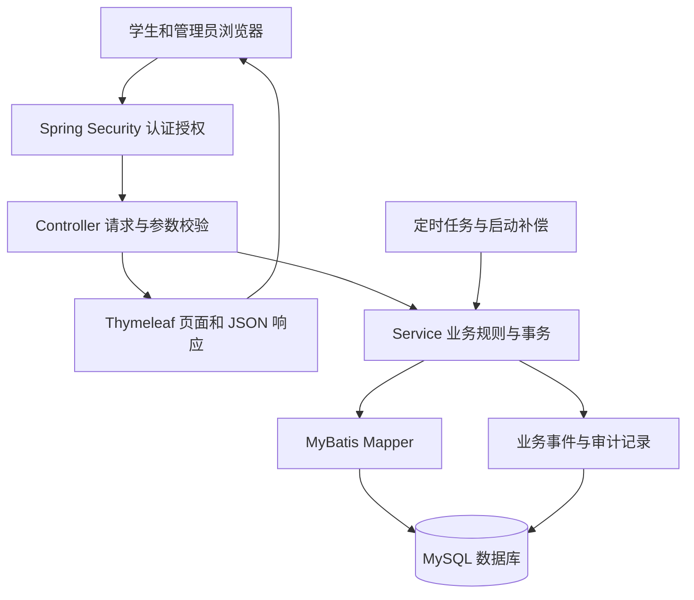
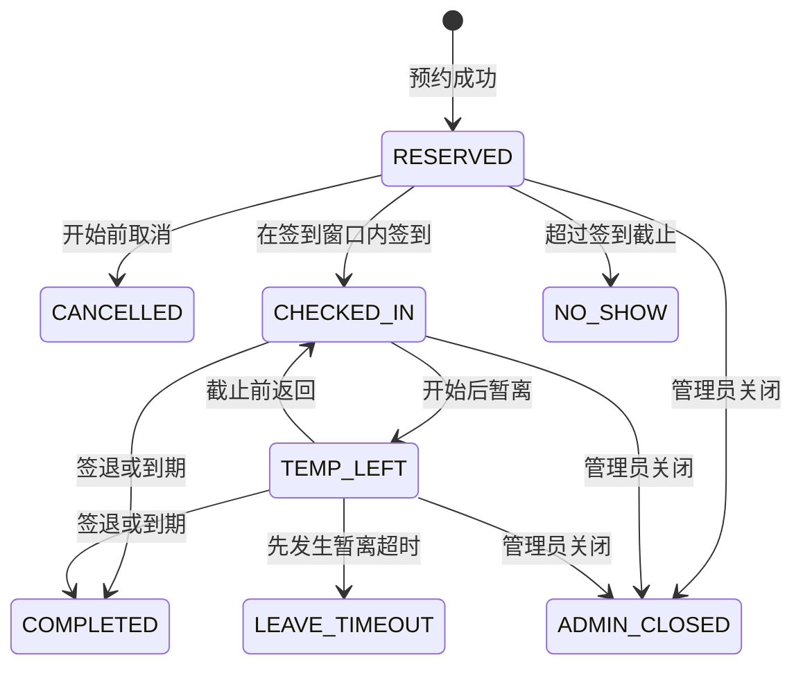
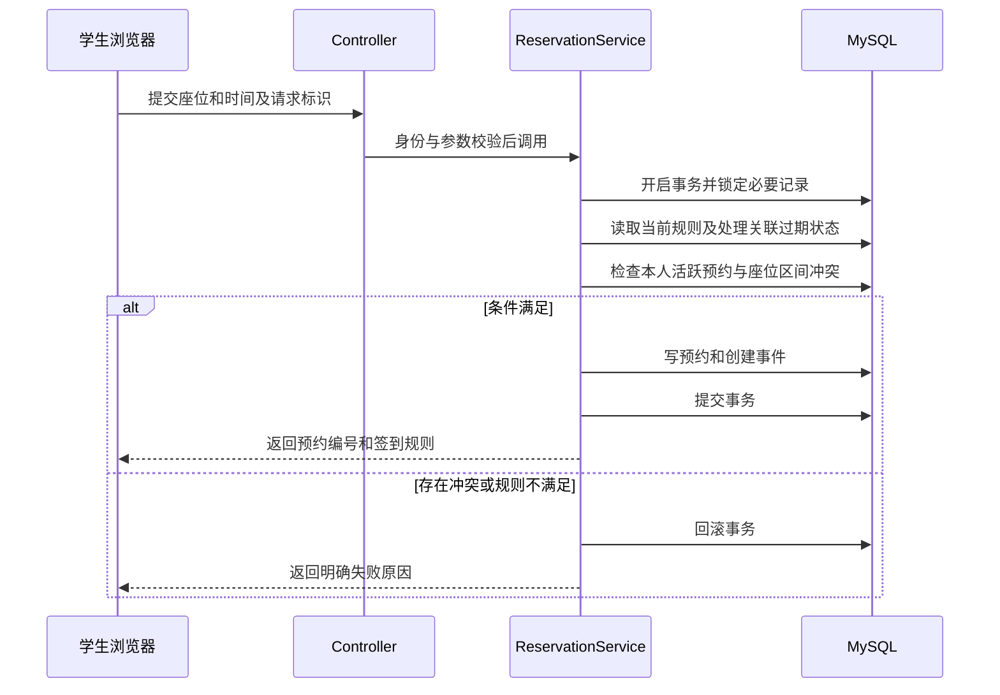
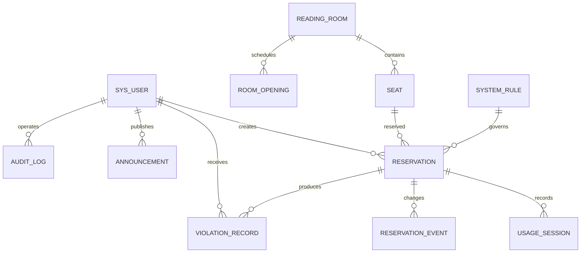

# 基于 Spring Boot 的图书馆座位预约管理系统设计方案

版本：v0.1 设计建议稿。日期：2026 年 10 月 9 日。

本方案面向毕业设计，目标是完成一个可以实际运行、演示完整预约流程、解释关键技术并提供测试证据的 Java Web 系统。指导材料的约束见《01-毕业设计指导阅读与约束.md》。本文中的开放时间、违约处理和预约参数均是演示规则建议，不是已核实的学校制度。当前不创建 Spring Boot 工程、不编写业务代码、不宣称功能已完成。

## 一、选题与范围

建议论文题目：**基于 Spring Boot 的图书馆座位预约管理系统设计与实现**。

系统管理的是图书馆的学习座位，而不是图书借还。它让学生在浏览器中选择阅览室、日期、时段和座位，提交预约，到场签到，短暂离座后返回，最后签退；管理员维护场地、座位和开放规则，并处理异常预约、违约记录与公告。

计划解决的问题包括座位信息不直观、预约冲突、预约后不到场、离座长期占用和人工处理缺少记录。以上是选题假设，后续应通过学校实际使用情况或访谈验证，不写成已经开展过调研的结论。

### 首期功能边界

| 分类 | 内容 |
| --- | --- |
| 首期完整实现 | 身份认证、学生与管理员权限、阅览室与座位管理、时段选座、预约与取消、签到、暂离与返回、签退、超时释放、违约记录、公告、简单统计、操作日志 |
| 完成主流程后可扩展 | 违约申诉、CSV 导出、到场动态码校验、座位收藏 |
| 首期不纳入 | 微信小程序、校园统一认证、门禁硬件、人脸识别、定位签到、短信、支付、AI 推荐、微服务和多机部署 |

这一范围足以支撑需求分析、数据库、业务流程、关键技术实现及测试章节。扩展功能只有在核心流程和异常处理稳定后加入。

## 二、用户与权限

首期设置学生和管理员两种角色，角色存于数据库，不从网页提交的角色字段确定权限。

| 能力 | 学生 | 管理员 |
| --- | --- | --- |
| 浏览开放信息、座位、公告 | 允许 | 允许 |
| 新建预约 | 仅本人 | 不默认代约 |
| 查看预约 | 仅本人 | 全部，可按条件筛选 |
| 取消、签到、暂离、返回、签退 | 仅本人且状态合法 | 异常处理使用单独管理操作 |
| 查看违约信息 | 仅本人 | 全部 |
| 管理账号、房间、座位、开放时间 | 禁止 | 允许 |
| 设置规则、发布公告、统计和审计 | 禁止 | 允许 |

学生账号由管理员建立或导入，演示环境使用明确标记的测试账号。暂不开放任意学号自注册，避免出现填写别人学号即可占用身份的问题。管理员通过独立初始化方式建立，学生页面不能创建管理员。用户被停用后禁止新增预约，既有预约由管理员按停用原因处理，不能让删除账号造成历史记录丢失。

## 三、技术路线

建议使用 **B/S 架构、单体应用、MVC 与分层设计**。前后端在同一 Spring Boot 应用部署，浏览器加载页面后通过少量异步请求更新座位状态。

| 层次 | 建议技术 | 用途 |
| --- | --- | --- |
| 开发语言 | Java，JDK 21 | 业务逻辑和后端开发 |
| 应用框架 | Spring Boot 3.5.x，实施时固定具体补丁版本 | 自动配置、依赖管理、启动与部署 |
| Web 层 | Spring MVC、内嵌 Tomcat | HTTP 请求、控制器、页面路由 |
| 页面 | Thymeleaf、HTML、CSS、JavaScript | 服务器渲染页面、座位网格、表单和异步交互 |
| 数据访问 | MyBatis + 兼容 Boot 3 的 Spring Boot Starter | 参数化 SQL、映射、锁查询和统计 |
| 数据库 | MySQL 8.4，InnoDB，utf8mb4 | 持久化、事务与约束 |
| 认证授权 | Spring Security、Session | 登录、角色与资源权限、CSRF 防护 |
| 参数校验 | Jakarta Bean Validation | 日期、时段、长度及请求字段校验 |
| 定时任务 | Spring Scheduling | 未签到、暂离超时、预约结束处理 |
| 构建与测试 | Maven、JUnit、Spring Boot Test | 可重复构建和必要测试 |
| 统计展示 | 普通表格优先，图表可选 ECharts | 趋势、预约量、签到率 |

Java Web 在本项目中体现为 HTTP、Servlet 容器、Session、MVC、网页表单、模板渲染和 JDBC 数据访问，不必为了“Java Web”额外混用 JSP、原始 Servlet 和多个持久化框架。若教师明确要求 JSP 或 Vue，再评估替换页面方案。

Spring Boot 3.5 的官方要求至少 Java 17，本方案使用 JDK 21 属于兼容范围；依据：[Spring Boot 3.5 System Requirements](https://docs.spring.io/spring-boot/3.5/system-requirements.html)。MyBatis、驱动与 Spring Security 的具体版本在开始工程时按兼容矩阵和 Boot 依赖管理核验并锁定，不直接照抄参考论文旧依赖。

### 架构示意

控制器只处理请求与响应；Service 统一负责预约状态变化、规则检查和事务；Mapper 负责 SQL。定时任务和管理员操作也调用同一套业务服务，避免存在多套互相矛盾的状态逻辑。

建议包结构为 `config`、`security`、`controller`、`service`、`mapper`、`entity`、`dto`、`vo`、`scheduler`、`exception`。实体不直接作为所有接口的输入或输出，账号密码摘要等内部字段不进入网页响应。

## 四、需求与模块

| 编号 | 模块 | 主要需求 | 可验收结果 |
| --- | --- | --- | --- |
| F01 | 账号与认证 | 学号登录、退出、改密、停用检查 | 学生只能操作本人数据；管理员页面受保护 |
| F02 | 场地管理 | 房间名称、楼层、说明、容量、启停 | 停用房间不能产生新预约；历史记录保留 |
| F03 | 座位管理 | 座位编号、网格位置、插座/靠窗属性、启停 | 按房间显示真实布局；停用座位不可预约 |
| F04 | 开放安排 | 常规时间、日期例外、闭馆、预约规则 | 闭馆及不合法时段被后端拒绝 |
| F05 | 座位查询 | 日期、起止时间、房间、座位属性 | 显示整个所选时段可用的座位 |
| F06 | 预约管理 | 提交、确认、个人记录、开始前取消 | 重复请求不生成重复预约；冲突明确提示 |
| F07 | 使用流程 | 签到、暂离、返回、签退 | 按合法状态转换更新；记录实际使用区间 |
| F08 | 自动处理 | 未签到、暂离超时、预约到期 | 释放占用且只记一次违约 |
| F09 | 违约管理 | 本人记录、限制预约、管理员撤销 | 可说明违约原因；撤销保留审计记录 |
| F10 | 信息发布 | 公告发布、撤下、规则查看 | 学生能看到已发布公告和当前规则 |
| F11 | 统计 | 预约量、签到率、违约量、使用率估计 | 时间范围与统计口径明确，不混淆预约和使用 |
| F12 | 审计 | 管理改动、异常关闭、规则变更记录 | 有操作者、对象、时间和原因可追溯 |

## 五、业务规则建议

### 1. 默认演示参数

以下值只是可修改的设计起点，学校未确认前以“演示规则”显示。

| 参数 | 建议默认值 | 说明 |
| --- | --- | --- |
| 时区 | Asia/Shanghai | 服务器统一业务时间，不依赖浏览器时钟 |
| 每日开放 | 08:00—22:00 | 可按阅览室和特殊日期覆盖 |
| 时间步长 | 30 分钟 | 起止时间对齐半小时，不跨天 |
| 可预约日期 | 今日与未来 2 天，共 3 个日期 | 明确区分“未来两天”和“总共三天” |
| 单次时长 | 30 分钟至 4 小时 | 结束时间必须不晚于闭馆时间 |
| 活跃预约上限 | 每人 1 条 | 包括未来待签到、使用中、暂离中；结束后再约 |
| 新建预约起点 | 不早于服务器当前时刻 | 例如 10:07 最早选择 10:30，不允许预约过去 |
| 签到范围 | 开始前 10 分钟至开始后 15 分钟内 | 提前签到只登记到场，使用计时从预约起点开始 |
| 暂离 | 每次最多 30 分钟，每次预约最多 2 次 | 到期必须返回；暂离期间座位继续保留 |
| 自助取消 | 预约开始前且尚未签到 | 开始后通过签到/超时处理，不用取消规避违约 |
| 违约限制 | 滚动 7 天有效违约达 3 次，限制新预约 3 天 | 不影响查看记录；不自动终止已成立预约 |
| 扫描周期 | 约 30 秒 | 逻辑有效期由时间决定，不能靠任务是否已执行判断 |

预约区间使用半开区间 `[start_time, end_time)`：09:00—10:00 与 10:00—11:00 不冲突。冲突条件是已有占用起点小于新终点，并且已有占用终点大于新起点。

### 2. 座位状态的三个层次

**静态状态**存于座位表：启用、停用。不能把某个预约时段的“已预约”长期写成座位的全局状态。

**时段可用状态**根据查询日期、起止时间和有效预约计算：可预约、该时段被占用、闭馆、停用。查询完整区间，不能只检查开始时刻。

**现场状态**用于当前时刻展示：待到场、使用中、暂离中、空闲。早于预约起点的到场签到不意味着已经开始占座。颜色必须配文字/图标，不能只依赖颜色判断。

### 3. 提前签到与连续预约

签到允许提前 10 分钟，但有效占用和使用会话起点不早于预约开始。若 10:00 前的座位正在被上一位学生使用，下一位即使 09:55 完成到场登记，也必须等到 10:00；系统页面显示“已签到，等待开始”。首期不提供额外提前占用功能。

新预约结束时间固定。提前签退或超时结束释放的是尚未使用的余下区间，已经发生的使用区间仍要保留，统计与审计不能把它当作从未占用。

## 六、预约生命周期

| 状态 | 英文标识 | 允许的后续动作 |
| --- | --- | --- |
| 待签到 | RESERVED | 合法窗口内签到、开始前取消、未签到超时、管理员关闭 |
| 已签到 | CHECKED_IN | 预约起点后暂离、签退、结束时间到达、管理员关闭 |
| 暂离中 | TEMP_LEFT | 截止前返回、签退、暂离超时、结束时间到达、管理员关闭 |
| 已完成 | COMPLETED | 只读 |
| 已取消 | CANCELLED | 只读，不记违约 |
| 未签到超时 | NO_SHOW | 只读，产生一次有效违约 |
| 暂离超时 | LEAVE_TIMEOUT | 只读，产生一次有效违约 |
| 管理员关闭 | ADMIN_CLOSED | 只读，要求填写原因；不自动记学生违约 |

边界约定：签到时刻等于截止时刻允许，超过才判未签到；返回时刻等于暂离截止允许。达到预约结束时间时不允许继续暂离、返回或签到，只返回终态。暂离截止取“暂离开始 + 30 分钟”和“预约结束”较早者；若两者相等或预约结束先到，按正常到期完成处理，不误记暂离违约。

自动终止的有效时间取原截止时间，而非扫描任务实际运行时间。例如暂离截止 10:30、任务 10:31 才处理，结束区间按 10:30 截断。未签到预约在签到宽限截止前保留，超过截止即在逻辑上失效。

## 七、关键流程

### 1. 查询与预约

学生登录 → 选择日期与时间 → 选择阅览室 → 按整段时间查询可用座位 → 查看座位详情 → 确认规则 → 提交 → 后端重新校验并写入 → 显示预约详情。

确认页显示房间、座位号、起止时间、签到截止和规则。查询到空闲不是锁定座位；另一人先提交成功时，后端返回“该时段已被预约，请重新选择”，并刷新座位图。

### 2. 签到与使用

学生打开本人预约 → 后端检查本人身份、预约状态、当前时间与签到窗口 → 写签到事件。若时间已到预约起点，建立使用会话；若提前签到，起点仍记录为预约开始。暂离关闭当前在座会话并设置返回截止；返回建立下一段在座会话；签退关闭会话并进入终态。

首期采用网页登录后的签到按钮，并在设计说明中明确：此模式只验证账号和时间，**不能证明学生实际到馆**。如果教师要求到场验证，可增加阅览室现场动态码及过期校验；动态码仍不等价于门禁硬件验证，不能写成已经实现的定位签到。

### 3. 自动释放和补偿

定时任务扫描待签到、暂离和已到结束时间的记录，逐条进入与人工操作相同的事务服务，锁定后重查状态再处理。应用重启时执行补偿扫描；查询和提交关键操作也判断实际截止时间，避免服务短暂停止后一直占座。

任务重复执行时不重复关闭记录、不重复插入违约。违约表设置预约与类型的唯一约束，状态更新要求原状态匹配；数据库错误时整体回滚，后续扫描可重试。

### 4. 管理停用与临时闭馆

管理员首先看到受影响预约数量，再选择生效时间并填写原因。短期维护按日期关闭或座位停用表达。对已有预约必须显式处理：关闭受影响预约、释放余下区间、关闭使用会话、写事件与审计。不能只改启用标志而让学生仍看到可使用的预约。

同一房间的停用生效与新建预约通过房间记录锁串行协调；首期管理操作按单个房间提交。既有预约被管理关闭不计学生违约。用户可在个人记录看到具体原因。

## 八、数据库设计

### 1. 设计原则

使用 InnoDB 与 utf8mb4；主键 `BIGINT`；学号使用字符串保留前导零；时间统一按上海本地业务时间存储 `DATETIME`，服务、数据库连接和测试保持一致。首期不跨时区预约。

核心外键关系保持完整。房间、座位和账号有历史引用时采取停用而非物理删除。规则修改有版本及生效时间，已有预约保留创建时规则快照，不能因管理员修改宽限时间而追溯处罚。

### 2. 概念关系

### 3. 表设计建议

下面是逻辑字段草案，进入详细设计时再补齐每个字段的长度、空值、默认值、枚举和索引 DDL。

| 表 | 主要字段 | 约束与用途 |
| --- | --- | --- |
| `sys_user` | id、student_no、password_hash、name、class_name、role、enabled、must_change_password、blocked_until、created_at | student_no 唯一；密码只存强摘要；禁约和停用分开 |
| `reading_room` | id、code、name、floor、description、enabled、created_at | code 唯一；不另存可由启用座位数量推导的容量 |
| `seat` | id、room_id、seat_no、row_no、col_no、has_socket、near_window、enabled | (room_id, seat_no) 唯一；(room_id, row_no, col_no) 唯一 |
| `room_opening` | id、room_id、schedule_type、weekday、special_date、open_time、close_time、is_closed | 常规按星期；例外按日期；例外优先；首期每房每天最多一个开放区间 |
| `system_rule` | id、version、effective_at、advance_days、slot_minutes、max_duration_minutes、checkin_early_minutes、checkin_grace_minutes、leave_minutes、leave_limit、violation_window_days、violation_limit、block_days、created_by | 版本唯一；新版本新增记录；首期固定半小时步长，不在线任意更换 |
| `reservation` | id、reservation_no、user_id、seat_id、start_time、end_time、status、checkin_at、leave_at、leave_deadline、leave_count、finished_at、finish_reason、rule_id、rule_snapshot、request_key、created_at、updated_at | 编号唯一；(user_id, request_key) 唯一；start_time < end_time；快照存签到和违约参数 |
| `usage_session` | id、reservation_id、start_time、end_time、end_reason | 每段实际在座区间；暂离切断会话；最多一个未关闭会话由事务校验保障 |
| `reservation_event` | id、reservation_id、from_status、to_status、event_type、occurred_at、actor_type、actor_id、reason | 记录创建、签到、暂离、返回和结束；定时任务标为 SYSTEM |
| `violation_record` | id、reservation_id、user_id、type、occurred_at、reason、is_revoked、revoked_by、revoked_at、revoke_reason | (reservation_id, type) 唯一；撤销保留原记录 |
| `announcement` | id、title、content、status、published_at、created_by、created_at | 只展示已发布公告；内容默认纯文本 |
| `audit_log` | id、operator_id、operation、target_type、target_id、reason、before_summary、after_summary、created_at | 记录管理动作；不写密码、Session 标识等敏感值 |

房间开放安排须保证一个星期日或特殊日期的记录唯一，实施时用相应唯一索引/规范化键实现，不能仅依赖两个可空字段的普通唯一约束。公告和审计可使用同一账号表的管理员外键。

### 4. 必要索引

- 座位冲突查询：`reservation(seat_id, status, start_time, end_time)`。
- 本人活跃预约与历史：`reservation(user_id, status, start_time)`。
- 超时扫描：`reservation(status, start_time)`、`reservation(status, leave_deadline)`、`reservation(status, end_time)`，具体取舍以执行计划为准。
- 违约统计：`violation_record(user_id, is_revoked, occurred_at)`。
- 使用统计：`usage_session(reservation_id, start_time)`。

普通唯一索引只能阻止完全相同键值，不能直接保证两个任意时间区间不重叠。必须配合下述事务检查。

## 九、并发与数据一致性

### 1. 防止重复占座

首期采用数据库事务与已有记录的悲观锁。新建预约在同一事务中按固定顺序锁定：**房间 → 用户 → 座位 → 需要变化的预约**，随后使用当前读检查条件，再写入预约与事件。相关操作遵守相同顺序；不在事务内等待人工确认或访问外部服务。

锁用户记录可防止同一学生同时预约不同座位，锁座位记录可防止不同学生预约同一座位。锁的是一定存在的父记录，不能只锁查询结果为空的预约集合。房间锁用于协调闭馆/停用与预约，代价是同一房间写操作串行化；对首期单馆演示规模可接受，后续只有实测必要才细化锁粒度。

预约状态变化先读取不可变的关联 ID，再按相同顺序加锁并重查数据；不能先锁预约，再反过来锁用户/座位。跨房间批量管理拆成单房间事务；批量锁同类记录时按 ID 排序。锁超时或死锁返回可重试提示，不把未提交结果当成功。

数据库行锁需要显式事务，事务提交或回滚释放锁。技术依据：[MySQL 8.4 Locking Reads](https://dev.mysql.com/doc/refman/8.4/en/innodb-locking-reads.html)。不能用 Java `synchronized` 代替数据库保护。

### 2. 防止重复提交与误改终态

预约创建携带每次确认生成的 `request_key`，与用户 ID 建唯一约束。同键、相同参数返回既有预约；同键、不同参数拒绝。按钮禁用只是体验措施，后端仍必须处理重复请求。

状态修改带原状态条件，并检查影响行数。两个签到请求只有一个能改变状态；第二个返回当前结果。签退与超时任务竞争时，先提交的合法转换生效，后者重查后返回终态。预约变更、使用会话、违约和事件在同一事务中提交，避免出现座位释放了但使用会话没结束的情况。

### 3. 有效占用区间

预约开始前，待签到预约保留整个计划区间。进入使用后按计划终点保留余下座位；取消后不再保留；提前签退、暂离超时、管理关闭按有效结束时间截断。过去已经发生的保留/使用区间保留审计信息，新预约只允许从当前或未来开始，因此不会占用过去区间。

即便扫描任务尚未处理，查询与预约也必须按实际时间识别过期记录；在提交事务内补偿相关记录后重查冲突。已有规则快照确定其超时，不能用新配置临时计算旧预约截止。

## 十、页面与交互规划

本节只确定信息结构与业务状态，不制作可运行原型。视觉样式在后续页面设计阶段细化。

### 学生端

| 页面 | 主要内容 | 关键交互 |
| --- | --- | --- |
| 登录 | 学号、密码、错误提示 | 空值、错误凭据、停用账号有明确提示 |
| 首页 | 当前预约、开放公告、预约入口 | 当前预约显示下一步操作和截止时间 |
| 预约选座 | 日期、起止时间、房间、属性筛选、座位网格、图例 | 先选时段再选座；切换条件时清除旧选择 |
| 座位确认 | 房间、座位、时间、规则 | 明确提交；冲突后刷新，不保留过时成功提示 |
| 我的预约 | 状态筛选、历史列表 | 点击查看详情，不显示他人的姓名或学号 |
| 预约详情 | 状态、时间线、签到/暂离/返回/签退 | 只显示当前允许的动作；后端再次校验 |
| 我的违约 | 原因、发生时间、有效/撤销、禁约期限 | 显示限制原因与恢复时间 |
| 公告与规则 | 当前公告、开放与预约规则 | 日期、来源和生效时间清晰 |
| 个人信息 | 学号、姓名、班级、修改密码 | 学号和角色不可自行修改 |

### 管理员端

| 页面 | 主要内容 |
| --- | --- |
| 管理概览 | 当日预约、当前使用、待签到、违约提示，明确各指标范围 |
| 阅览室管理 | 房间列表、楼层、启停、开放时间和特殊日期 |
| 座位管理 | 按房间查询、网格位置、属性、批量创建建议、停用 |
| 预约管理 | 学号/日期/房间/状态筛选、详情、管理员关闭 |
| 用户管理 | 创建学生账号、停用、强制改密、禁约信息 |
| 违约管理 | 查询、查看关联预约、填写原因撤销 |
| 公告管理 | 新增、修改、发布、撤下 |
| 规则配置 | 新版本预览、生效时间、变更说明 |
| 统计与日志 | 指标、日期范围、事件与管理操作记录 |

座位网格用行列坐标生成，保留过道空白位置；每个座位显示编号。窄屏允许网格横向滚动，日期与确认信息保持可见。停用、占用和可选都有文字提示。返回上一页保留筛选条件，但必须重新获取可用状态。

需要覆盖加载中、暂无开放房间、所有座位不可用、登录过期、预约冲突、禁约、已被管理关闭和网络提交结果未知等状态。网络中断后先查询同请求标识的结果，不能提示用户换标识无限重试。

## 十一、接口与路由草案

页面路由和数据接口在同一应用，认证使用 Session。以下为接口契约设计，不是已实现接口。

| 方法 | 路径 | 功能与权限 |
| --- | --- | --- |
| POST | `/login` | Spring Security 登录处理，凭据不放 URL |
| POST | `/logout` | 退出，清除会话 |
| GET | `/api/rooms` | 登录用户获取可展示房间 |
| GET | `/api/rooms/{id}/seats` | 按日期和起止时间查询座位 |
| POST | `/api/reservations` | 本人预约；seatId、startTime、endTime、requestKey |
| GET | `/api/me/reservations` | 分页查询本人记录 |
| GET | `/api/reservations/{id}` | 本人详情或管理员授权查询 |
| POST | `/api/reservations/{id}/cancel` | 本人开始前取消 |
| POST | `/api/reservations/{id}/check-in` | 本人签到 |
| POST | `/api/reservations/{id}/leave` | 本人暂离 |
| POST | `/api/reservations/{id}/return` | 本人返回 |
| POST | `/api/reservations/{id}/check-out` | 本人签退 |
| GET | `/api/me/violations` | 本人违约及限制信息 |
| GET/POST | `/api/admin/rooms`、`/api/admin/seats` | 管理员查询/新增；修改采用各自的明确动作接口 |
| POST | `/api/admin/reservations/{id}/close` | 管理员关闭，原因必填 |
| POST | `/api/admin/violations/{id}/revoke` | 管理员撤销违约，原因必填 |
| POST | `/api/admin/rules` | 新增生效规则版本 |
| GET | `/api/admin/statistics` | 管理员统计，必须提供日期范围 |

POST 请求带 CSRF 令牌。接口不信任客户端的 userId、role、status、违约计数或当前时间，操作者来自登录身份。查询参数采用服务端校验，分页设最大页大小。

数据接口响应建议包含 `code`、`message`、`data`；失败配合 HTTP 状态：未认证 401、无权限 403、参数不合法 400、状态/预约冲突 409。传统网页未登录可重定向登录页，JSON 接口不返回一段登录 HTML。创建成功返回预约标识及当前状态；返回对象不包含密码摘要。

## 十二、安全与运维设计

密码使用 BCrypt 等 Spring Security 支持的密码摘要；登录后更新会话标识，Cookie 设置 HttpOnly，正式 HTTPS 部署启用 Secure。所有写操作保留 CSRF 防护；按学号和来源限制过量登录尝试，限制参数在实施时确定。

数据访问使用 MyBatis 参数绑定，不能拼接来自用户的 SQL；排序字段采用白名单。公告默认纯文本并转义输出。账号修改使用专门请求对象，避免学生提交角色字段实现提权。敏感管理动作都记录原因和日志。

数据库连接参数由外部配置提供；源码和论文截图不暴露真实口令。演示数据库使用虚构账号并明确标注。数据库账号仅授予项目需要的权限。备份和恢复通过受控运维流程完成，首期不把“网页执行任意 SQL”作为管理功能。

交付为单个可运行 JAR + MySQL 数据库，静态资源尽量本地打包，不依赖答辩现场外网。首期本地运行不要求 Docker；若后续部署服务器，再补 HTTPS 和反向代理配置。启动说明包含 JDK/MySQL 要求、建库、配置、运行、测试账号和恢复步骤。

## 十三、统计口径

| 指标 | 口径 |
| --- | --- |
| 预约量 | 统计创建时间落在范围内的预约数量，并单独展示取消/管理关闭等状态 |
| 签到率 | 按预约开始时间属于范围且签到截止已过的预约为基础，排除开始前取消和不归责学生的管理关闭；已签到数 / 有效应到场数 |
| 未签到违约率 | 同一应到场基础上的 NO_SHOW 数 / 有效应到场数 |
| 当前使用数 | 当前在预约有效区间内的 CHECKED_IN 数；提前签到未开始不计 |
| 暂离数 | 当前有效 TEMP_LEFT 数；与在座人数分开 |
| 使用率估计 | 范围内在座会话分钟数之和 / 同期有效开放座位分钟数之和 |

实际在座会话跨统计范围时取交集；暂离期间不计在座分钟。分母按房间开放时间、特殊闭馆和座位停用区间计算，不能简单用“总座位 × 24 小时”。当前设计若只保存座位最新启停状态，无法准确复原历史分母，因此首期使用率只对状态固定的明确演示时间范围计算；若需要生产历史统计，增加可用性历史记录后再验收。分母为零显示“暂无可计算数据”。

由于按钮签到无法证实真实在场，指标名称使用“系统记录的使用率估计”，不能声称传感器实测使用率，也不能在未测量前声称提高了多少百分比。

## 十四、测试与验收计划

本阶段给出计划，所有“实际结果”“通过/失败”待代码完成后填写。

| 编号 | 场景 | 预期结果 |
| --- | --- | --- |
| T01 | 学生直接请求管理接口 | 403，数据不变化 |
| T02 | 学生访问另一个学生的预约 ID | 拒绝访问，不泄露个人记录 |
| T03 | 正常预约、签到、暂离、返回、签退 | 状态顺序正确，事件完整，使用会话闭合 |
| T04 | 不同学生同时预约同座同段 | 仅 1 个成功，其余冲突；无重叠有效预约 |
| T05 | 同一学生同时预约不同座位 | 最多 1 条活跃预约 |
| T06 | 相邻区间与部分重叠区间 | 相邻允许，部分/包含重叠拒绝 |
| T07 | 半小时不对齐、过去时间、超长、跨天、闭馆 | 后端拒绝 |
| T08 | 签到提前边界、截止边界及超时 | 按边界规则处理；提前签到不提前计时 |
| T09 | 未签到、暂离超时、结束时间同时接近 | 正确分类；无重复违约；按有效截止释放 |
| T10 | 重复请求、重复任务、重复签到 | 结果可重放，预约及违约不重复 |
| T11 | 签退/签到与任务并发 | 一个合法转换生效，关联数据保持一致 |
| T12 | 应用停机后重启 | 自动补偿过期记录；查询与提交不被陈旧状态阻塞 |
| T13 | 新规则版本生效 | 新预约采用新规则；旧预约按快照处理 |
| T14 | 停用房间与创建预约并发 | 不产生生效后非法预约；受影响旧预约有关闭原因 |
| T15 | 违约限制与撤销 | 禁约截止正确；撤销重新计算限制，保留审计 |
| T16 | 缺失 CSRF、SQL 注入文本、脚本文本 | 写操作被保护，参数不改变 SQL 结构，输出被转义 |
| T17 | 事务在写事件或违约时失败 | 预约、会话、违约一起回滚，无半成品状态 |
| T18 | 统计无数据、分母零、范围裁剪、暂离 | 口径正确，不产生错误百分比 |

违约限制的计算以未撤销的有效记录为准：新达到阈值的违约触发限制，限制期取已有期限与本次触发时间加限制天数的较晚值。管理员撤销后，在锁用户的事务中按有效违约时间顺序重新计算，避免只删除记录却不恢复预约资格。过去已执行的限制也保留审计事实。

并发与事务测试使用真实 MySQL/InnoDB，不用只支持不同锁语义的内存数据库代替。可使用可控时钟测试时间边界，不让自动测试实际等待 15 或 30 分钟。

建议演示数据为 3 个阅览室、每室约 40 个座位、20 个虚构学生和 1 个管理员；另生成明确标注的 1 万条历史测试记录用于查询测试。性能目标建议：普通查询在 100 个并发请求的指定本地测试环境中 P95 不超过 2 秒，预约写入无重复占座；这只是待验证目标。最终报告记录 CPU、内存、数据库配置、请求类型、成功率与耗时，不把冲突响应当成性能成功吞吐。

## 十五、论文组织与证据对应

正式格式要求使用“一、”“（一）”编号。推荐正文框架如下，摘要、目录、参考文献单独设置。

| 正文章节 | 内容 | 需要的真实证据 |
| --- | --- | --- |
| 一、绪论 | 背景、问题、目标和范围 | 实际调研或可核验来源；明确假设 |
| 二、相关技术与可行性分析 | Java Web、Spring Boot、MVC、MyBatis、MySQL、成本和操作可行性 | 采用的版本、官方资料和开发环境 |
| 三、需求分析 | 用户、权限、功能、业务规则、非功能要求 | 角色用例图、功能表、规则定义 |
| 四、系统设计 | 架构、模块、状态、数据库、并发和页面信息结构 | 架构图、流程图、E-R 图、数据字典 |
| 五、系统实现 | 关键模块实现、事务、认证、定时任务与页面 | 实际源码片段、真实运行截图；不堆砌无关代码 |
| 六、系统测试 | 正常、异常、边界、并发和重启补偿 | 测试环境、输入、预期、实测、截图与问题修复记录 |
| 七、总结与展望 | 已完成内容、限制和后续工作 | 对实际成果诚实总结，不将规划写成成果 |

关键词建议：Spring Boot、Java Web、座位预约、MyBatis、MySQL，共 5 个。文献准备至少 6 篇真实相关资料，覆盖座位预约业务、Java Web、数据库事务和权限设计；正式条目的作者、出版信息或访问日期经核实后填写。本方案中的官方技术链接不是已经满足要求的整套论文参考文献。

建议逐步保留：学生预约流程截图、管理座位截图、超时处理截图、冲突测试日志、数据库结构、部署步骤和测试结果。参考材料可借鉴结构，正文由本项目实际设计与实现形成。

## 十六、阶段安排

| 阶段 | 建议时间 | 产出与进入下一阶段的条件 |
| --- | --- | --- |
| 需求与方案细化 | 10 月 9 日—10 月 18 日 | 确认选题、核心范围和业务规则，补齐数据字典与用例 |
| 页面与数据库详细设计 | 10 月 19 日—10 月 25 日 | 页面线框、字段和索引、接口契约；核心流程可解释 |
| 最小完整流程 | 10 月 26 日—11 月 8 日 | 登录、座位查询、预约、取消、签到、签退可运行 |
| 生命周期与管理功能 | 11 月 9 日—11 月 22 日 | 暂离、自动释放、违约、场地管理和公告 |
| 验证与论文整理 | 11 月 23 日—12 月 10 日 | 必要测试、截图、部署说明和论文正文 |
| 初稿交付准备 | 12 月 11 日—12 月 19 日 | 在文件规定的 12 月 20 日前准备作品与初稿 |
| 终稿修订 | 初稿反馈后—2027 年 1 月 2 日 | 按反馈修订，准备真实查重报告及签署材料 |

这是工作建议，不是教师新发布的时间安排；用户当前仅要求完成设计，不按时间表自动开始编写。

## 十七、后续需要确认的事项

现有信息足够形成这一版方案，下列事项在进入对应实施阶段前核实，不影响当前设计交付。

1. 本题目是否已经登记，教师是否另有 Java/JSP/Vue 或版本要求。
2. 图书馆实际房间、座位布局、开放日期、预约时长、签到与暂离规则。
3. 签到只做演示按钮，还是要求现场动态码；首期按钮方案的能力限制应保留。
4. 学校如何提供学生账号，是否需要对接统一认证。
5. 最终承诺书签署、Word/PDF 合并顺序及查重边界以哪个通知为准。
6. 个人封面信息与指导教师资料，在论文排版阶段填写。

当前建议先审阅业务范围与规则，再开展页面线框和数据库详细设计。设计稿确认并修订后，它才成为实施基线；后续变更应同步影响数据库、接口、测试与论文说明。
