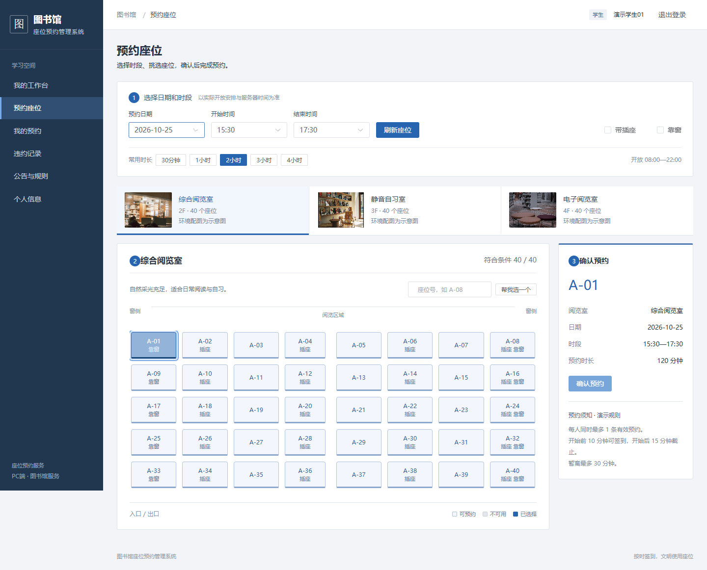
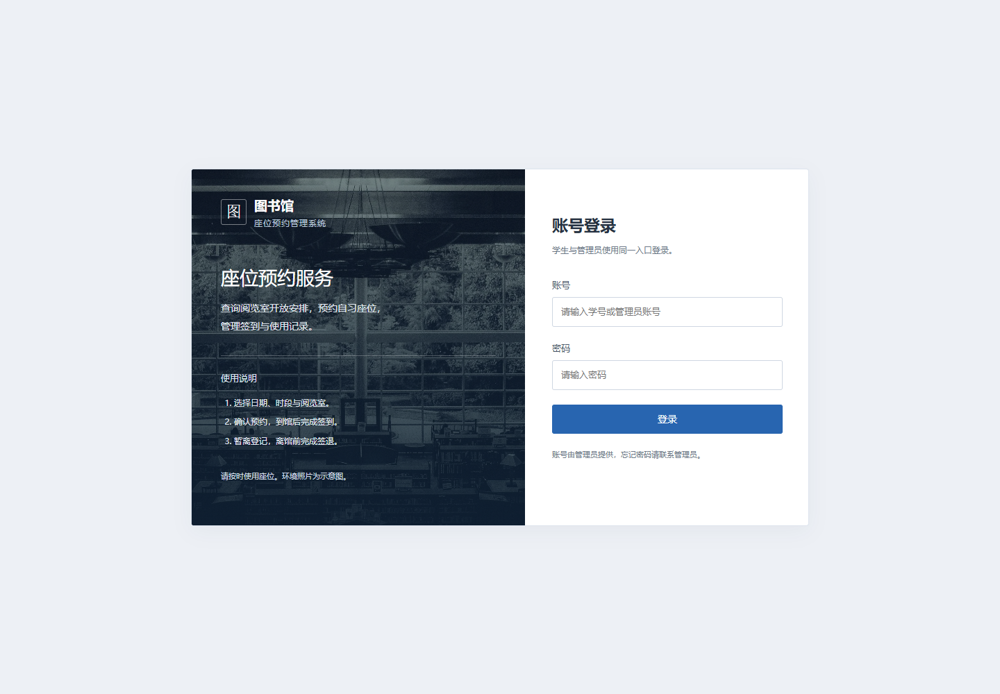
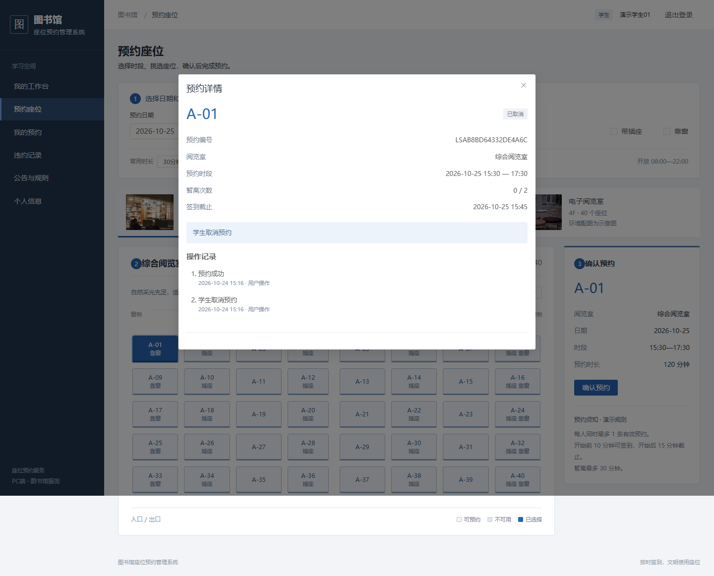
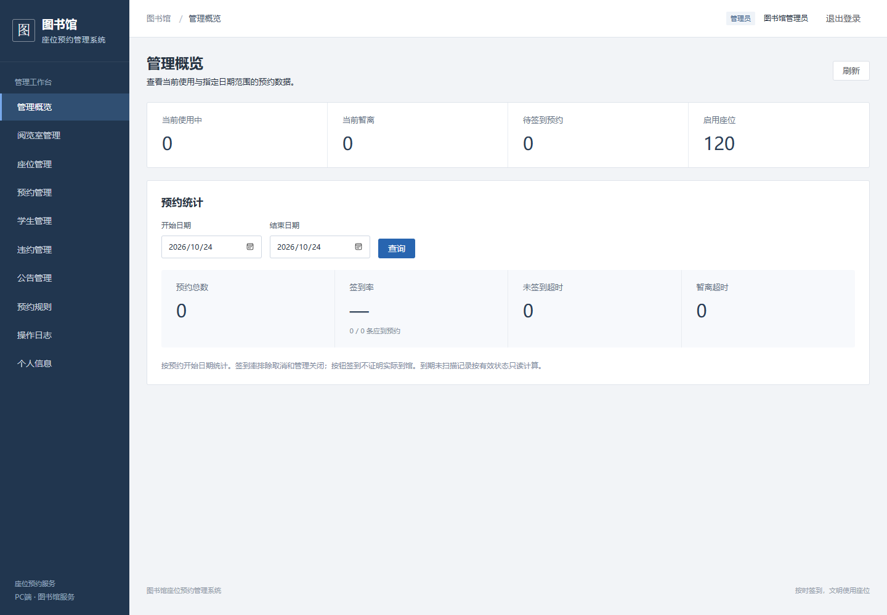
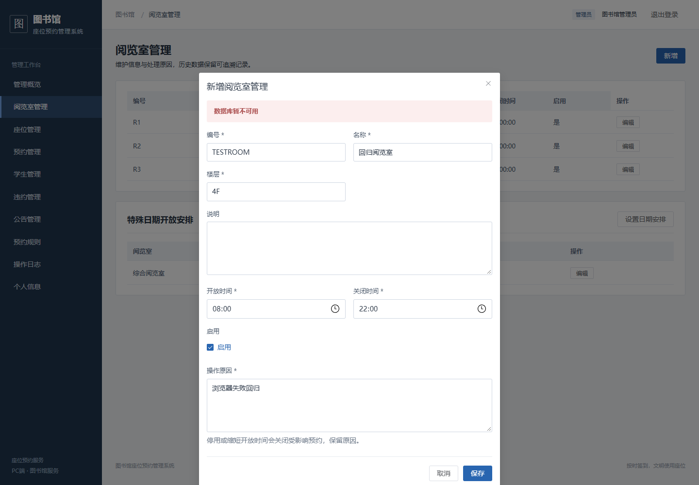

# 界面图集

[返回首页](../README.md) · [快速启动](../README.md#快速开始) · [文档中心](README.md)

以下页面来自已打包应用的实际浏览器操作，演示账号与数据用于课程展示。点击图片可查看原图；图书馆配图是环境示意，来源见[素材说明](../src/main/resources/static/images/SOURCES.md)。

## 预约座位

选择日期、时段和阅览室，按编号、插座与靠窗筛选；座位按钮支持键盘操作。确认区汇总所选座位、时段和规则，成功提交后才保留座位。

## 账号登录

学生与管理员共用入口，登录后按服务端角色显示页面。账号由管理员提供，密码使用 BCrypt 哈希保存。

## 预约详情

详情展示原规则下的预约时间、签到截止、状态与操作事件。下图为完成取消后的记录，仍保留预约与取消事件；活动预约会按服务器时间提供相应操作与倒计时。

## 管理员概览

查看当前使用、暂离、待签到与启用座位数量，并按日期查询预约与签到情况。图中的 120 个座位来自演示种子。

## 表单失败恢复

字段缺失时提供可聚焦的错误汇总。保存失败后保留输入并显示错误；下图通过浏览器回归模拟 503 响应，展示恢复路径。

## 验证与版本

以上流程与[浏览器回归](TESTING.md#浏览器6项)对应；测试代码见 [library.spec.js](../web/e2e/library.spec.js)。旧版的[登录页](images/login.png)、[选座页](images/seat-reservation.png)和[管理概览](images/admin-dashboard.png)保留用于迁移前后对照。
