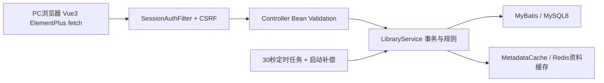
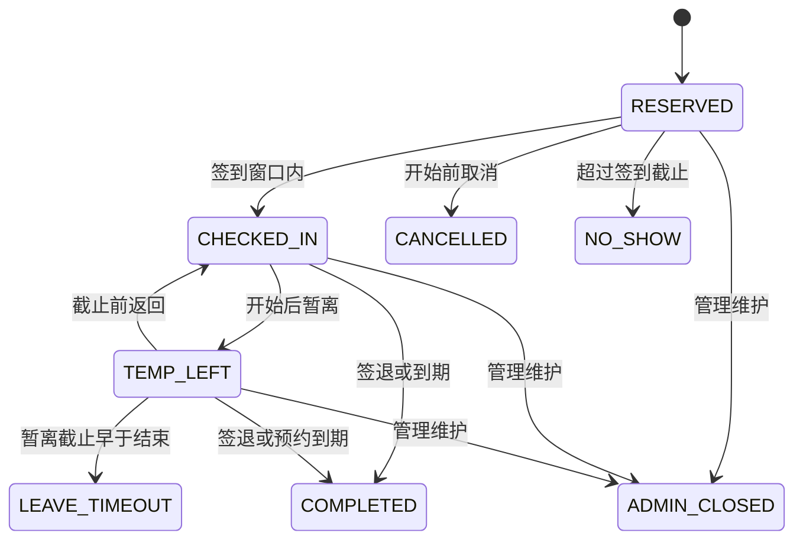

# 当前架构与预约状态

前端web/，后端包cn.edu.library。保留现有mapper XML、Models和业务入口；独立提取EffectiveState纯判定、MetadataCache、SessionAuthFilter，避免在本轮建立通用流程框架。

## 事务与时间

所有写入口通过TransactionTemplate，先SELECT write_guard WHERE id=1 FOR UPDATE，再读取影响决策的数据。隔离级别READ_COMMITTED。预约、事件、usage_session、违约和审计在相同事务提交；缓存删除注册afterCommit。统一guard会限制写吞吐，本轮保留以保证用户、场地维护和规则变更间的一致性。

业务Clock固定Asia/Shanghai，API提供带+08:00的serverTime。Vue集中做时区转换，倒计时只负责显示。签到截止等于时刻仍有效；超过才NO_SHOW。暂离截止早于预约结束且超过才LEAVE_TIMEOUT；暂离截止等于预约结束按COMPLETED。提前签到的usage_session开始不早于预约开始。

每条预约绑定原rule_id。usage_session按签到/返回开始，暂离/签退关闭，保留实际使用区间供核对。终态不重复处理，违约另有(reservation_id,type)唯一约束。管理关闭不记学生违约；撤销违约重新计算封禁，不直接清空。

## 只读展示与恢复

GET bootstrap/seats/detail/list/violations/statistics不持guard、不写库。EffectiveState纯函数用于详情/列表；SQL用同样的CASE边界过滤有效占用和状态分页。返回persistedStatus与stateComputed；计算结束并不表示事件和违约已归档。

超时SQL分别按签到截止、暂离截止和预约结束筛候选；每支和外层最多200条，按id顺序及id>after推进。在guard内重读后处理，批次提交后继续。排序统一为id，避免截止时间与id顺序不同导致漏处理。MySQL仍可能为到期候选排序；并非恒定时间扫描。写入预约时仅补处理本人/目标座位关联超时记录，再检查封禁和最多一条有效预约。拒绝预约时整个事务回滚，相关超时由后续扫描归档；不会放行被限制的预约。

## 缓存边界

| key后缀（前缀library:metadata:v1:） | 内容 | 提交后删除 |
|---|---|---|
| rooms | 阅览室资料/座位数量 | 阅览室、座位维护 |
| seats:{roomId} | 编号/网格/插座/靠窗/启用 | 对应房间座位维护 |
| rules | 规则版本列表，按当前时间选展示版本 | 新增规则 |

TTL120秒+随机0—30秒。Redis读取、反序列化、填充、删除失败均有日志并回源/等待TTL。查询缓存不含用户权限、预约最终状态、可用性判定；可用性由实时SQL计算，book重新读数据库座位、开放安排、规则和用户。并发填充可能在失效后写回短期旧资料，TTL兜底；不承诺严格一致的展示缓存。

Session只存userId/authVersion及CSRF token。每次API请求重新加载用户角色和启用状态；写事务内再次核对。停用/改密/重置递增auth_version。客户端身份头和userId参数无认证效力。角色变更尚无API，未来增加时必须同样递增版本。单实例重启会丢失登录状态，业务历史在MySQL保留。

管理停用/闭馆前先处理相关预约的到期状态，防止把已错过签到的记录重分类为ADMIN_CLOSED。手工关闭已过期记录会先提交原规则的到期归档，再返回409；不会因错误响应回滚应有的违约。
