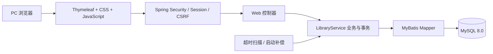
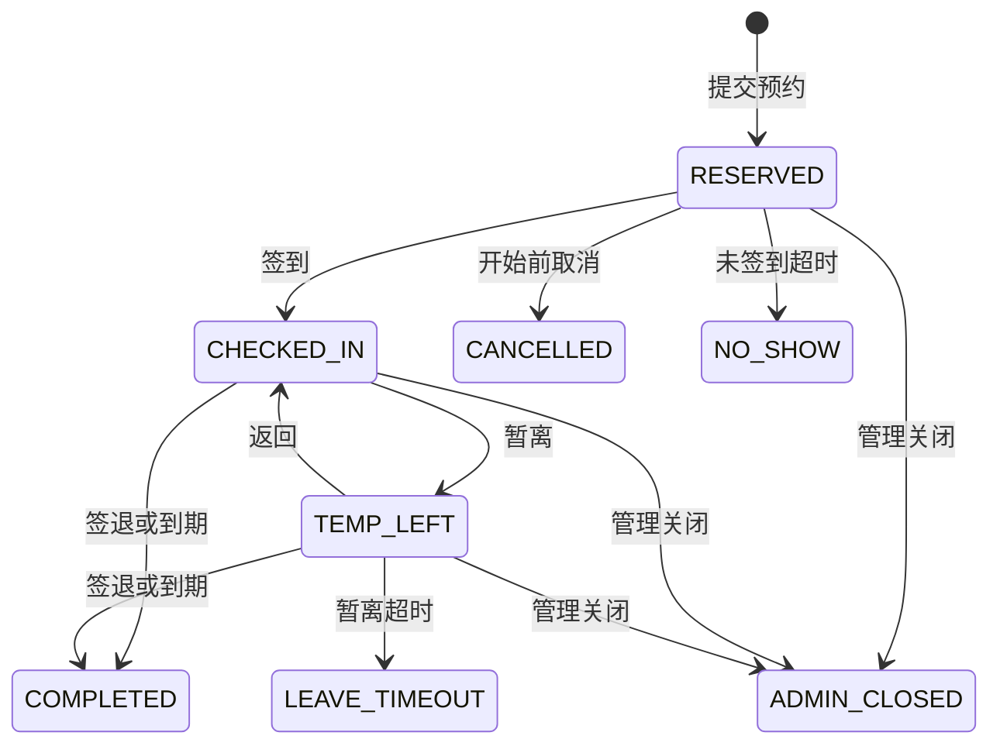

# 架构与测试

## 技术分层



| 位置 | 职责 |
| --- | --- |
| `config/` | 认证授权、演示初始化、超时调度 |
| `web/` | 页面入口、API、参数校验与统一异常响应 |
| `service/` | 预约规则、状态变化、权限检查与事务 |
| `mapper/` + `resources/mapper/` | 数据访问接口与 SQL |
| `model/` | 用户、场地、预约、规则等数据模型 |
| `resources/templates/` + `resources/static/` | 服务端模板与浏览器静态资源 |
| `resources/db/schema.sql` | 首次建表，不包含破坏性删除 |

## 预约生命周期



终态记录保留详情与时间线，具体状态边界由业务层判定。

## 一致性与权限

- 写操作通过数据库 `write_guard` 行锁统一串行化；预约、使用区间、事件、违约与日志在同一事务中提交。
- 请求标识用于预约幂等；同一学生和同一座位的重叠时段由业务层检查。
- 预约引用创建时的规则版本，后续规则变更不会追溯修改既有预约。
- Spring Security 负责角色授权，业务层核验本人数据；密码采用 BCrypt，写请求受 CSRF 保护。
- 未签到、暂离超时和预约到期由后台扫描处理，启动时补偿；浏览器倒计时仅用于展示。
- 场地停用、闭馆和开放时间缩短立即处理受影响预约，并保留关闭原因。

统一行锁适合当前规模，会限制并发写吞吐；并发测试不等于大规模性能测试。

## 验证

先按[部署文档](deployment.md)启动专用 MySQL，然后执行：

```bash
mvn -B -ntp verify
```

`LibraryIntegrationTest` 包含 19 项测试，覆盖完整生命周期、20 人并发抢座、同人跨房间并发、幂等、时段重叠、时间边界、暂离超时、规则版本、管理关闭、违约撤销、事务回滚、权限、CSRF、登录、特殊开放日期、个人预约筛选及重置密码后的旧登录失效。

测试使用 `library_seat_test`，每项测试前会清理业务表，并在清理前断言数据库名称。不得把 `TEST_DB_URL` 指向正式库或演示库。

GitHub Actions 使用 Java 21 与独立 MySQL 8.0 服务执行相同命令。测试环境通过 `TEST_DB_URL`、`TEST_DB_USER`、`TEST_DB_PASSWORD` 覆盖，参见 `src/test/resources/application-test.yml`。
